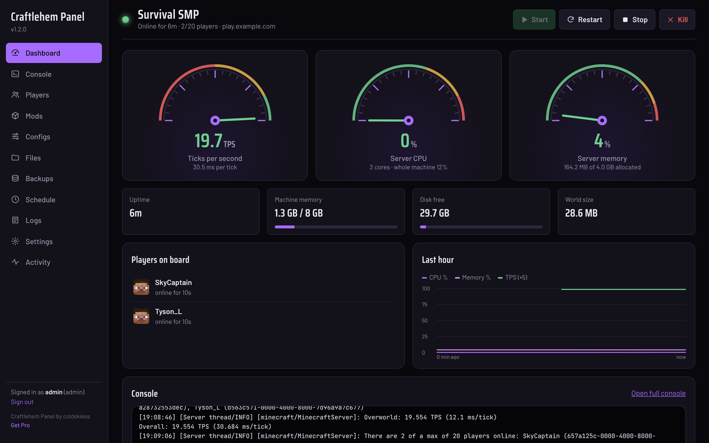
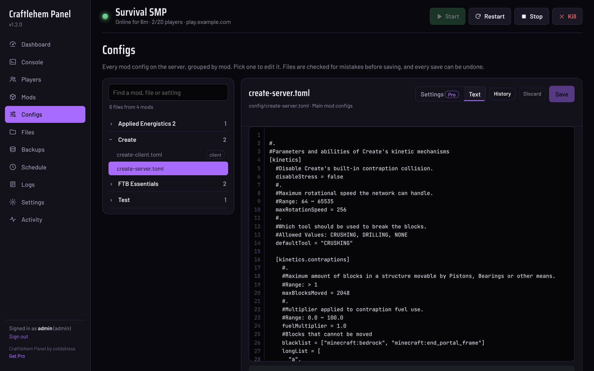
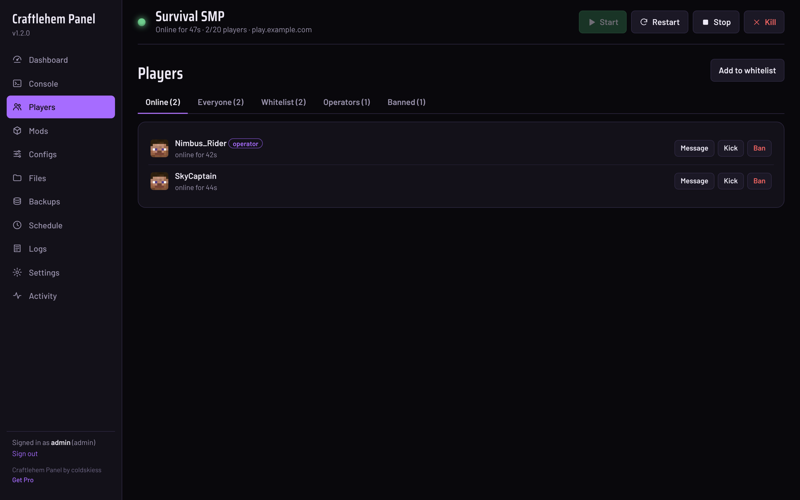
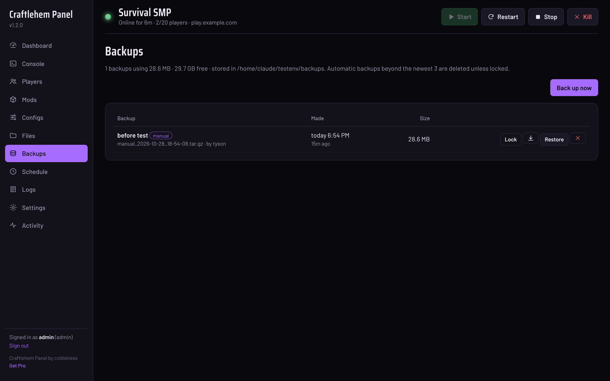
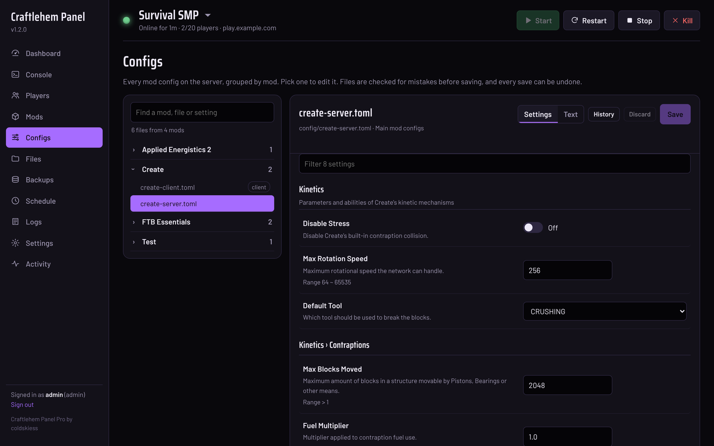
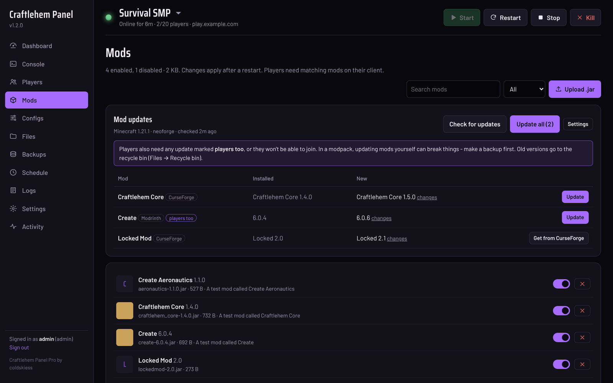
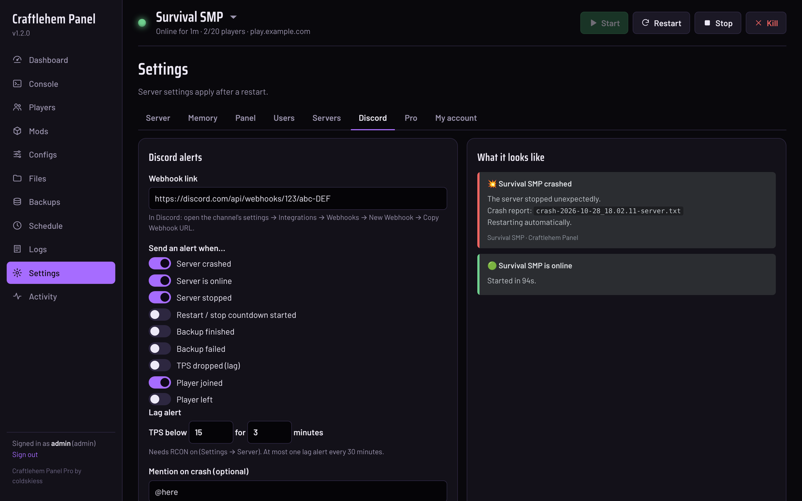

# Craftlehem Panel

A free, self-hosted web control panel for **modded Minecraft servers** on Linux. It's built for big NeoForge / Forge modpacks like All The Mods. Install it with one command, then run your server from any browser, including your phone.



## What it does

- **Live dashboard:** TPS, CPU and memory gauges, who's online, disk space, world size and an hour of history.
- **Start, stop and restart with warnings:** players get a countdown in chat ("Server restarting in 5 minutes (Updating mods)").
- **Crash recovery:**
  - Spots crashes and links the crash report.
  - Restarts automatically, but gives up after 3 crashes in 10 minutes so it can't loop forever.
  - Brings the server back after a reboot if it was running before.
- **Console:** live output with command history, and filters for errors, warnings or chat.
- **Players:**
  - Message, kick or ban people.
  - Playtime and "last seen" for everyone who's ever joined.
  - Whitelist, operators and bans.
  - Works with chat mods that add rank prefixes, like `[VIP] Name [Admin]`.
- **Mods:** real names, versions and icons read from each jar. Turn mods on or off, drag in new jars, and delete them.
- **Config editor:**
  - Every mod config grouped by mod.
  - Search for a setting by name across every file.
  - Checks the file for mistakes before saving.
  - Undo any save from its history.
- **Files:** browse and edit the server folder in the browser. Deletes go to a recycle bin for 14 days.
- **Safe backups while the server runs:**
  - Pauses saving, flushes the world, archives it, then resumes.
  - Restore in one click. Your current world is kept, never deleted.
- **Schedule:** a nightly restart and a backup every 6 hours are set up by default. Timed commands and broadcasts too.
- **Logins for your staff:**
  - Viewer can look only.
  - Moderator can start/stop, use the console and manage players.
  - Admin can do everything.
  - An activity log records who did what.
- **Settings:** a friendly `server.properties` editor and a RAM slider.

Minecraft runs in its own `tmux` session, so restarting or updating the panel never kicks your players.

| Configs | Players | Backups |
|---|---|---|
|  |  |  |

## Install

You need a Linux machine (a VPS or a home server) with Ubuntu 24.04, Debian 12 or newer, and `sudo` access. Paste this:

```bash
curl -fsSL https://raw.githubusercontent.com/coldskiess/craftlehem-panel/main/get.sh | sudo bash
```

The installer:
- asks where your server is, what it's called and which port the panel should use
- installs what it needs (Python, tmux, zstd, and Java 21 if it's missing)
- offers to turn on RCON
- creates your admin login
- starts the panel as a service

Then open `http://your-server-ip:8080`.

Prefer to do it by hand? Download `craftlehem-panel.zip` from [Releases](https://github.com/coldskiess/craftlehem-panel/releases), unzip it to `/opt/craftlehem-panel` and run `sudo bash install.sh`.

**New to Linux or self-hosting?** [docs/SETUP.md](docs/SETUP.md) walks through everything step by step. That includes reaching the panel safely from outside your home with a free Cloudflare Tunnel, with no port forwarding.

### Updating and removing

```bash
sudo bash /opt/craftlehem-panel/update.sh      # latest release; keeps your settings, users and data
sudo bash /opt/craftlehem-panel/uninstall.sh   # removes the panel; never touches your server or backups
```

The panel shows a notice when a new version is out.

## Craftlehem Pro

An optional paid add-on (US$14.99 once, including updates) that funds development. The free panel above stays complete and free.

- **Config Settings view:** NeoForge configs become switches, dropdowns and number boxes that know the allowed range, with descriptions and a one-click reset to default.
- **Mod update checker:**
  - Finds newer versions of your mods on Modrinth and CurseForge for your exact Minecraft version and loader, and installs them in one click.
  - Flags updates that players need too.
- **Discord alerts:** crashes (with an optional @here), starts, stops, restarts, backups, lag and player joins.
- **Multiple servers:** run and switch between several Minecraft servers from one panel.

| Settings view | Mod updates | Discord alerts |
|---|---|---|
|  |  |  |

**[Get Craftlehem Pro on Gumroad](https://coldskiess.gumroad.com/l/craftlehem-pro)**. You install it from inside the panel under Settings → Pro.

## Requirements

- **Linux** with Python 3.11+. Ubuntu 24.04 and Debian 12 are tested. Other distros work if they have `tmux` and Python 3.11.
- **Any Java edition server:** vanilla, Paper, Fabric, Forge or NeoForge. The modpack features (mod list, config editor) are aimed at Forge/NeoForge/Fabric.
- **RCON** turned on (the installer can do it) for TPS and accurate player lists.

## Security

- **Logins:** passwords are hashed (PBKDF2), and an IP is locked out for 10 minutes after 8 failed logins.
- **Sessions:** cookies are signed and can't be used from another website.
- **Access:** file access is locked to the server folder, and roles control who can do what.
- **Internet:** don't open the panel's port to the internet. Use HTTPS through a [Cloudflare Tunnel](docs/SETUP.md#reach-it-from-anywhere-cloudflare-tunnel) or a reverse proxy instead.

Found a security problem? See [SECURITY.md](SECURITY.md).


## Licence

Craftlehem Panel is free software. Copyright © 2026 coldskiess. You can redistribute and change it under the terms of the [GNU General Public License v3](LICENSE).

The Craftlehem Pro add-on is sold separately under its own licence and isn't part of this repository.

Minecraft is a trademark of Mojang Synergies AB. This project isn't affiliated with or endorsed by Mojang or Microsoft.
